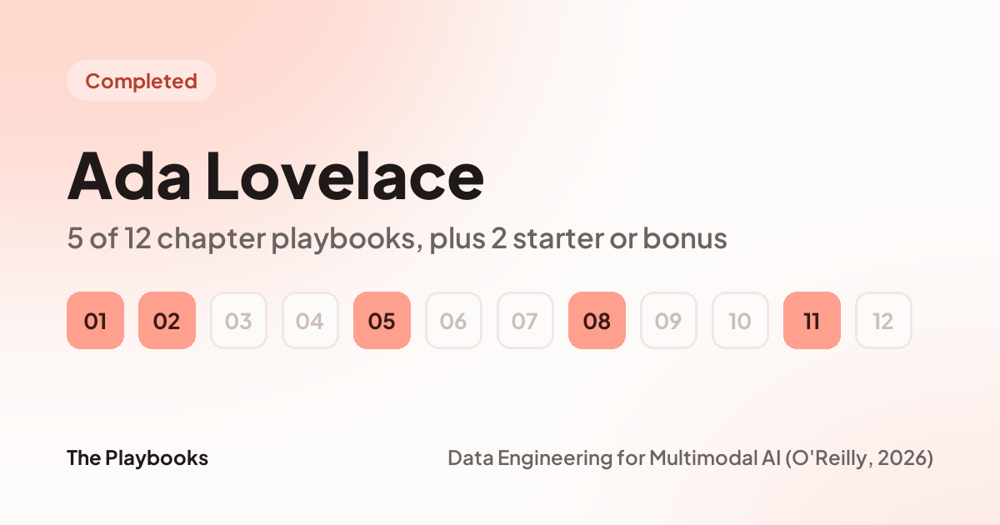

# Completion card

When `make run` passes in a playbook, it writes a small `.playbook-done` file in that playbook's folder. `make card` reads those files and draws a PNG you can share: your name, how many of the 12 chapter playbooks you finished, and the book title.



## Make yours

Clone this repository next to your playbook clones, then run:

```bash
git clone https://github.com/Data-Engineering-for-Multimodal-AI/.github.git
cd .github
make card
```

It asks for your name and writes `completion-card.png`. If your playbooks are somewhere else, pass the folder:

```bash
make card NAME="Your Name" DIR=~/code/playbooks
```

You need [uv](https://docs.astral.sh/uv/). Everything runs on your machine. Nothing is sent anywhere.

## Font

The card uses Plus Jakarta Sans, under the SIL Open Font License. See `fonts/OFL.txt`.
